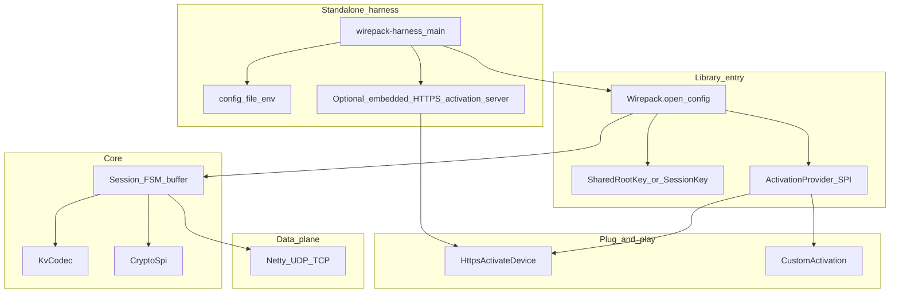

<!-- f77cab46-353e-4de9-9e2a-42a16d418fc1 -->
---
todos:
  - id: "spec"
    content: "Write PROTOCOL.md: frames, entity TLV, REGISTER, SafetyLimits"
    status: completed
  - id: "api-modules"
    content: "Maven scaffold: api (SPI), codec, core, netty, activate-http, harness"
    status: completed
  - id: "codec"
    content: "Entity TLV + FrameCodec with strict bounds checks and unit tests"
    status: completed
  - id: "session-buffer"
    content: "Retransmit buffer + session: lastRcv, bulk ACK/REQ, wrap window, capped memory"
    status: completed
  - id: "netty"
    content: "Netty UDP transport (shared event loop)"
    status: completed
  - id: "entry-activate"
    content: "Wirepack entry point (shared key) + ActivationProvider SPI + HTTPS activate-device plugin"
    status: completed
  - id: "harness"
    content: "Standalone prod-oriented harness (Netty UDP + config + limits + example peer)"
    status: completed
isProject: false
---
# Multipurpose binary transport library

## Goal

Greenfield **multi-purpose** Java library: K/V payloads, reliable UDP sessions, pluggable **activation / key bootstrap**, and a **standalone execution harness** robust enough to run as a production peer (not a toy demo).

**Defaults (locked):**
- Language: **Java 21**, Maven multi-module
- Data plane I/O: **Netty** (UDP primary; TCP adapter same frames) — not Tomcat for bulk data
- Activation / control: **pluggable** (HTTPS “activate device” is one plugin, not hard-wired)
- Location: [`/home/cursor-agent/wirepack`](/home/cursor-agent/wirepack) (**directory created**; implementation not started)
- Seq: **u16** wrapping; default window **2048**
- No `flags` field; nesting/fragmentation via K/V + `parentId`

## Why `magic` and `msgType` are separate

| Field | Job |
|-------|-----|
| **magic** | “Is this our protocol?” |
| **msgType** | “Which packet kind?” (`DATA` / `ACK` / `REQ` / …) |

## Architecture



### Netty vs “web server”

| Role | Stack |
|------|--------|
| **Data plane** (binary frames, ACK/REQ, file chunks) | **Netty** UDP/TCP only |
| **Activation / admin** (HTTPS “activate device”) | Separate: JDK `HttpClient` on device; **embedded HTTPS server** in harness example (JDK HTTPS server or Jetty) — **not** Tomcat-on-the-data-path |
| Tomcat/Spring | Optional in *apps* that embed the library; **not required** to run the harness |

## Library entry point (keyed conversation)

Primary API sketch:

```text
Wirepack.open(WirepackConfig config) -> WirepackRuntime
  config.sharedKey(byte[] | KeyMaterial)     // basis for two systems talking
  config.activation(ActivationProvider)      // optional plug-in
  config.transport(TransportFactory)         // default Netty UDP
  config.limits(SafetyLimits)                // max frame, buffer, sessions, rates
  config.crypto(CryptoSpi)                   // stub v0; AEAD v1

runtime.connect(PeerAddress) -> Session
runtime.listen(BindAddress) -> SessionAcceptor
```

- **Shared key** is the root of trust for the pair (or fleet material from activation).
- After activation, runtime may replace/derive **session keys** (`keyId` in clear header selects which).
- Apps never touch raw sockets unless they plug a custom `TransportFactory`.

## Plug-and-play activation

```text
interface ActivationProvider {
  ActivationResult activate(ActivationRequest req) throws ActivationException;
  // returns key material, keyId, peer endpoints, expiry, etc.
}
```

**Bundled plugin:** `HttpsActivateDeviceProvider`

- Device/client calls org HTTPS endpoint (e.g. `POST /activate`) with device identity
- Server returns key material + `keyId` + data-plane endpoint(s)
- Client passes result into `Wirepack.open(...)`

**Other plugins** (same SPI): file/env pre-shared key, mTLS enrollment, custom enterprise IdP — swap without changing core.

Harness can run **both sides of an example**: embedded HTTPS activation server + UDP data peer.

## Frame meta (locked shape)

Cleartext prefix for demux/crypto select:

| Field | Size | Notes |
|-------|------|--------|
| magic | u16 | clear |
| version | u8 | clear |
| keyId | u32 | clear — selects key; not secret |
| … | … | remainder clear in v0; AEAD-wrapped in v1 |

Then: `msgType`, `sessionId`, `streamId`, `seq` u16, `lastRcv` u16, `payloadLen` u16, integrity (crc32 v0 / AEAD tag v1).

ACK/REQ: no DATA seq consumption; bulk one-way uses standalone ACK + selective REQ.

## Payload: K/V + parentId

`(parentId, key, sizeBits, value)*` — JSON replacement + binary chunks. See prior plan sections (generality table unchanged in spirit).

## Encryption

- **v0 cleartext profile:** CRC + `CryptoSpi.noop()` when no shared key
- **v1 (default when PSK present):**
  1. OOB **PSK** = authenticity root (activation / config) — not bulk traffic key
  2. **HELLO** AEAD under `HKDF(PSK,"wirepack-v1-hello")` carries X25519 pubs
  3. **Immediate** `HKDF(PSK||ECDH_ss||pubs) → traffic_key`; shed PSK from seal path
  4. App DATA sealed with ChaCha20-Poly1305; payload = `nonce:12 || ct+tag`
  5. **Rekey** at `rekeyAfterPackets` (default 10000) via piggybacked `REKEY_*` under current key
  6. Algorithms: X25519, HKDF-SHA256, ChaCha20-Poly1305

See [PROTOCOL.md](PROTOCOL.md) Crypto.

## Retransmit buffer + reliability

Unchanged: per-stream buffer, piggyback `lastRcv`, bulk ACK cadence, selective REQ, u16 wrap, profiles BestEffort / Reliable / ReliableOrdered.

## Hardening (required for harness / prod)

All parsing and buffers are **length-prefixed with hard caps** — Java avoids classic C buffer overflows, but the same class of bugs is **OOM / DoS / unbounded allocation**. Treat these as release gates:

| Control | Rule |
|---------|------|
| Max UDP/TCP frame | reject if `payloadLen` or total size &gt; `maxFrameBytes` (e.g. 1200–8192 configurable) **before** allocating |
| Max K/V entries / depth | reject oversized trees |
| Max `sizeBits` | reject &gt; 65535; reject values that exceed remaining frame |
| Retransmit buffer | max bytes + max entries per session; fail send on overflow |
| Sessions | max concurrent sessions; idle timeout |
| Rates | optional token bucket on accepts / activates |
| Magic/version | drop unknown immediately |
| Integer math | checked overflow on length arithmetic |
| Direct buffers | Netty pooled arenas with limits; no unbounded retain |
| Activation HTTPS | TLS required in prod profile; request body size cap |

No `sun.misc.Unsafe` for parsing. Fuzz tests on frame decoder in CI.

## Module layout

```text
wirepack/
  PROTOCOL.md
  pom.xml
  wirepack-api/           # Wirepack, Session, SPI: Activation, Crypto, Transport, Limits
  wirepack-codec/         # Kv + Frame (strict bounds)
  wirepack-core/          # session FSM, buffer, open() wiring
  wirepack-netty/         # Netty UDP/TCP transport
  wirepack-activate-http/ # HttpsActivateDeviceProvider (+ optional tiny server helpers)
  wirepack-harness/       # standalone Main — prod-oriented example peer
```

## Standalone execution harness

`wirepack-harness` is a **runnable peer**, not a scratch demo:

- `java -jar wirepack-harness.jar --config harness.yaml`
- Modes: `listen` / `connect` / `activate-then-connect`
- Loads shared key from config **or** runs HTTPS activate flow first
- Optional embedded **HTTPS activation server** for local/prod-like bootstrap
- Netty data plane with all `SafetyLimits` enforced
- Structured logging, health on a local port (optional), graceful shutdown
- Documented as the reference deployment shape for “library as a standalone service”

## v0 deliverables

1. PROTOCOL.md + SafetyLimits
2. API + SPI (activation, crypto stub, transport)
3. Codec + session + Netty UDP
4. HTTPS activate-device plugin
5. Harness jar runnable listen/connect with caps + lossy integration test
6. README: embed API + run harness

## Non-goals (v0 cleartext / deferred)

- Continuous per-packet crypto ratchet as the default rekey mode
- Durable multi-day log / Kafka parity
- IDL generator
- Exactly-once
- Multicast (Phase 2)
- External Noise library (hand-rolled X25519+HKDF+ChaCha20-Poly1305)

## Implementation order

1. Spec + `SafetyLimits` + API/SPI
2. Codec with bounds tests + fuzz smoke
3. Session/buffer + Netty UDP
4. `Wirepack.open(sharedKey)` wiring
5. HTTPS activation plugin
6. Harness main + config + prod limits defaults
7. README
